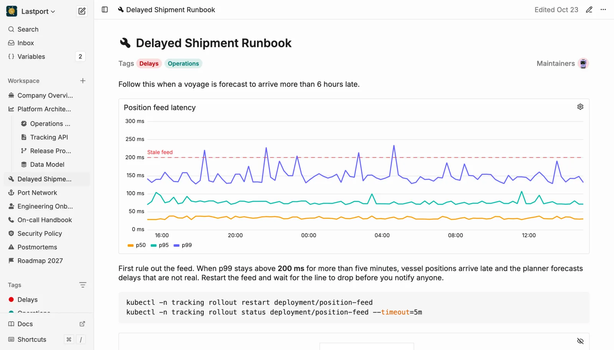
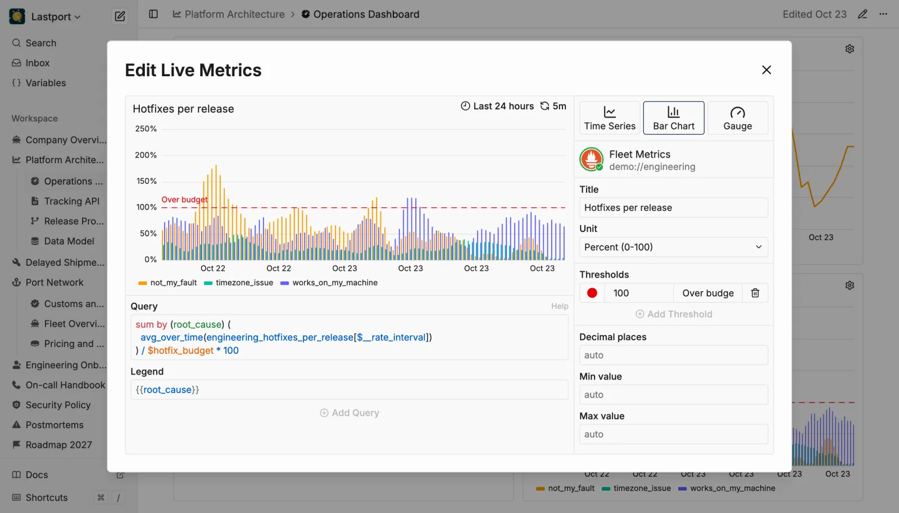
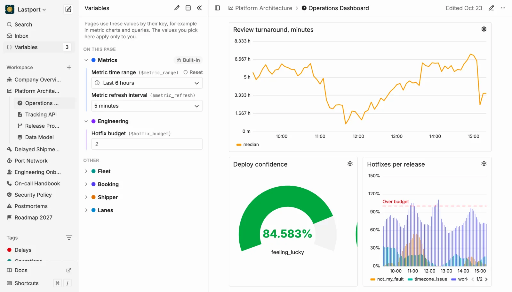
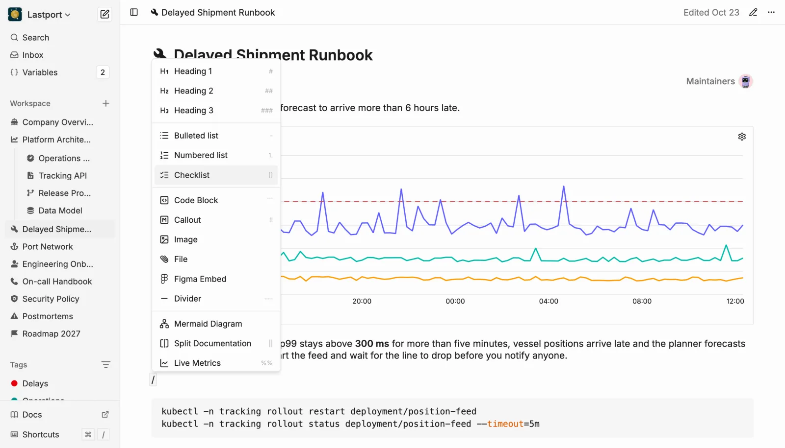
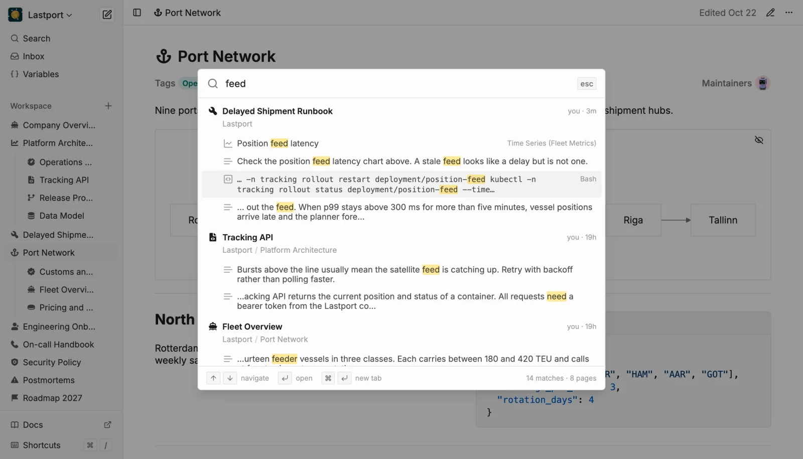
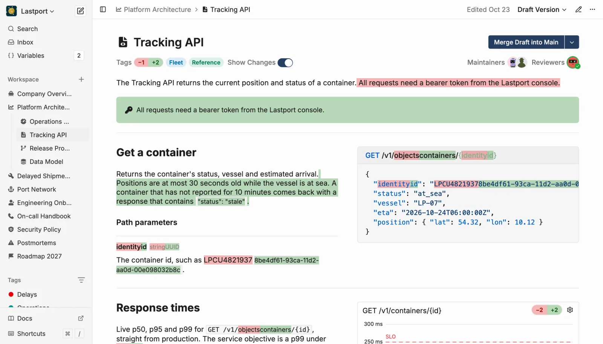
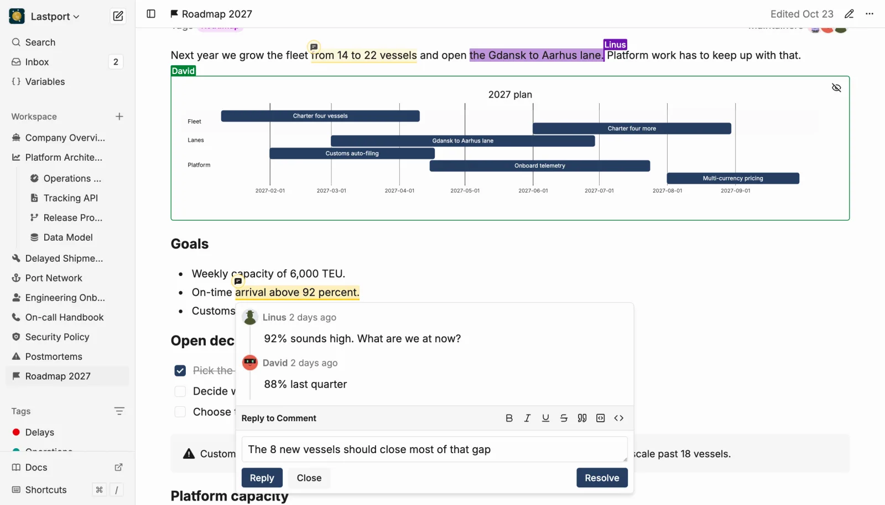
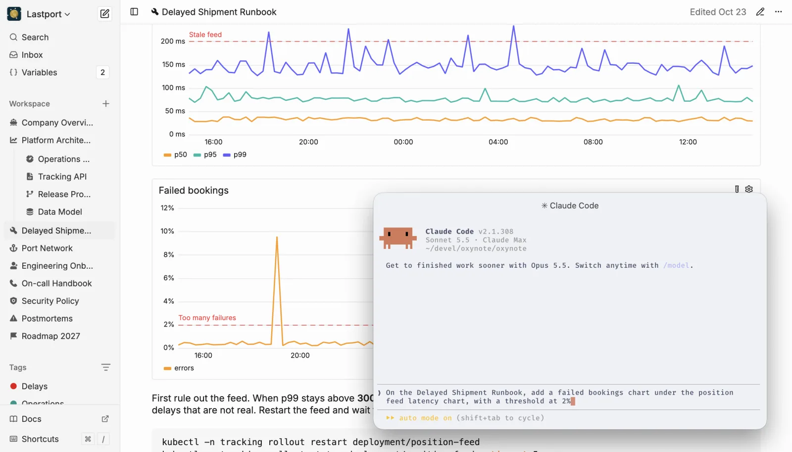

<div align="center">

# Oxynote

**Your system, with subtitles.**

A self-hosted workspace that puts live metric charts inside the pages that
explain them. The charts run your Prometheus and SQL queries, and a change
to a page goes through a draft, a diff and an approval, like a pull
request. From the authors of
[ttlcache](https://github.com/jellydator/ttlcache).

[](LICENSE)
[](https://github.com/oxynote/oxynote/releases)
[](https://discord.gg/mNJd5zJkvC)

</div>

<picture>
  <source media="(prefers-color-scheme: dark)" srcset="docs/images/chart-and-explanation-dark.webp">
  
</picture>

## Why Oxynote Exists

Keeping a service running takes several tools. You read about it in a wiki
such as Notion and watch its metric charts in Grafana or Datadog, while the
commands that fix it sit in a terminal history or a chat thread. When
something breaks, you connect all of that by hand, across tools with
separate logins and separate histories.

Oxynote is a new kind of tool because it puts the explanation and the live
metric charts on one page. Each chart runs its own Prometheus or SQL query,
and one draft carries a change to the chart and its text through the same
review.

The goal is to watch and run the service from that same page. Its uptime
monitor, its logs, a view into its database and its admin actions would sit
next to the explanation, and changes to them would go through the same
review. All of them are in development.

<details>
<summary>The long version is a bit of a rant, but it explains the <em>personal</em> why</summary>

For a long time, the most reliable documentation at my company was the
Slack chat I had with myself. How it got that way starts with
metric charts. We had a lot of them: Grafana, Sentry, for some reason a bit
of Datadog, and a few custom self-hosted HTML pages with charts on them.
On top of that, I was encouraged to run my own health checks for the
deployments I owned (why that could not live in Grafana or anything like
it, nobody could tell me). Those deployments were services pulling
financial market data over websockets. Under heavy volume they leaked
memory and got OOM killed. There was a bug in there somewhere that we
were chasing and could not find for a while, and in the meantime every
kill meant missed events, and missed events meant running backfill
scripts by hand. None of those charts showed any of that. So: cron, curl
against each service's status endpoint, and the result posted to me
privately on Slack. Not convenient at all.

Then there was everything else. Internal wikis still describing
deployment procedures for trial products that had ended. Secret vaults.
Server management commands and curl requests. None of it lived in one
place, and access was its own problem: each of these had a different
owner who could grant it, so a lot of my time went into finding out who
that was and then finding them. Since we talked on Slack, that is where
I asked for all of it, and that is where people answered, sometimes with
plain credentials (the horror). To not lose any of it, I forwarded those
messages to the chat with myself, which is how that chat became my
source of truth for a long time: links to the specific Grafana
dashboards that mattered out of the many we had, example curl requests
against other teams' services so I could match their responses when
integrating (neither the requests nor the responses were documented
anywhere), and server IPs with notes on what was deployed where.

Naturally, I did try to fix it. I wrote Notion docs and linked the
Grafana charts from them, and for a while that was fine. Then they
drifted apart. One doc explained the labels on our ingestion-rate chart,
market, region and so on, but new labels kept being added, nobody
documented them, half were not even used in the chart, and each one cost
Prometheus another time series. Keeping a doc and a chart in sync meant
links on both sides, in Notion and in Grafana, which was more work than
I wanted, plus switching browser tabs just to check that the explanation
and the chart still meant the same thing. And that was only
observability. Beyond it, admin actions were specific curl requests, and
feature flags lived in a service disconnected from everything else. All
of it deserved a proper review flow, like on GitHub, with diffs that work
for text, metric charts and other visual structures. Instead it had
none.

David ([@davseby](https://github.com/davseby)), who started Oxynote with me
([@swithek](https://github.com/swithek)), was the one who had to work
through a system and its documents the first time he was on call, at a
different company. He had years of Grafana and internal docs behind him and
expected it to be routine. What he got was Datadog, which he had never used,
and a wildly different Notion structure. Then, on that first shift, the
services that enrich image metadata failed. Search over user uploads turned
inaccurate, and from there it cascaded through the product. Monitors fired,
but none of them linked anywhere or said which service had started failing,
which made for a nerve-racking night of tying things together by hand. The
metric showing one service overloaded and unresponsive existed the whole
time. Datadog's UI is convoluted, though, and nothing explained what any
chart tracked, so David never found it. An AI agent connected to Datadog's
MCP server did.

What both of us wanted was the metric chart, the explanation, the command
and the flag on one page, edited together, reviewed like a pull request,
and readable by a tired person at night or by an agent. Each tool we had
was great at one of those things and paid little attention to the others.
So Oxynote starts with the pieces we needed most: pages people edit
together, live metric charts, reviews and Stripe-style API docs. Uptime
monitors, AI evals, a database viewer and admin actions are in
development.

</details>

## Quick Start

Oxynote is one container. Start it with Docker:

```sh
docker run -d -p 8080:8080 \
  -v oxynote_data:/oxynote/data \
  ghcr.io/oxynote/oxynote
```

Open http://localhost:8080 and sign in as `admin@example.com` with the
password `oxynote-admin-1234`. The login page shows both until you change
the password, so change it in the settings before anyone else can reach the
instance.

[docker/prod/README.md](docker/prod/README.md) covers the configuration,
from a real domain to an external PostgreSQL. To run from source, see
[CONTRIBUTING.md](CONTRIBUTING.md).

## Features

Oxynote keeps the pages about your systems, such as architecture notes, API
references, on-call steps and release checklists, in one page tree. Those
pages can query Prometheus, PostgreSQL, Supabase, MySQL or MariaDB, so the
live metrics sit right where you write about them.

### Live Metric Charts

<picture>
  <source media="(prefers-color-scheme: dark)" srcset="docs/images/chart-editor-dark.webp">
  
</picture>

A Live Metrics block draws a time series, a bar chart or a gauge from one
or more PromQL or SQL queries, and the editor redraws it as you type.
Thresholds and units sit next to the query. Grafana macros such as
`$__rate_interval` and `$__timeFilter` work too, so a query you already
use in Grafana usually moves over with a paste.

No metric yet? Pick a pattern such as latency or error rate, and the chart
draws simulated data until the real series arrives. SQL sources need a
read-only database user, so a page can never change your data.

### Variables

<picture>
  <source media="(prefers-color-scheme: dark)" srcset="docs/images/dashboard-dark.webp">
  
</picture>

Variables are defined once for the whole workspace, and any query on any
page can read them. `$metric_range` comes built in: set it to the last six
hours, and each chart that uses it shows the last six hours from then on.
The values you pick apply only to you, so they change your charts and
nobody else's.

### Blocks

<picture>
  <source media="(prefers-color-scheme: dark)" srcset="docs/images/slash-command-dark.webp">
  
</picture>

Type `/` for the block menu: headings, lists, checklists, code, callouts,
images, files, Figma embeds, Mermaid diagrams, Stripe-style API docs and
live metrics. Markdown shortcuts such as `##` work as you type. Two go
further: `%%` adds a live metric chart, and `||` starts an API doc with the
fields on one side and an example request on the other.

### Search

<picture>
  <source media="(prefers-color-scheme: dark)" srcset="docs/images/search-box-dark.webp">
  
</picture>

`⌘K` searches the whole workspace, down to a single line in a code block or
a diagram's source. Results come grouped by page, and each one says what it
matched, such as a Bash snippet or a time series chart. Typos are fine too.

### Reviews

<picture>
  <source media="(prefers-color-scheme: dark)" srcset="docs/images/review-dark.webp">
  
</picture>

Make a page reviewable, and its main branch stops taking direct edits.
Changes go into a draft branch instead. The diff works on blocks, so a
renamed API parameter and a moved chart threshold show up in red and green
right where they sit.

Reviewers approve the draft on the page itself. Merging is a separate step,
so an approved draft can wait until the change it describes goes live.

### Collaboration

<picture>
  <source media="(prefers-color-scheme: dark)" srcset="docs/images/collaboration-dark.webp">
  
</picture>

Everyone on a page shows up as a named cursor, along with the block they're
holding, and edits from several people merge as they type. Comments attach
to a single word or a whole block. New comments and replies land in your
inbox, and one click there opens the block they're on.

### Agents and MCP

<picture>
  <source media="(prefers-color-scheme: dark)" srcset="docs/images/mcp-dark.webp">
  
</picture>

Oxynote is designed for people first, and agents get an interface of their
own. Claude Code, Codex and many other MCP clients connect once you approve
them. They read each page as structured blocks and change only the blocks
they need. Their edits appear live, and on a reviewable page they wait in a
draft until a person approves them.

Rubber Duck, the built-in assistant, does the same inside the app. It runs
on a model from Anthropic, OpenAI, Google or OpenRouter, or a local one
through Ollama. Both stay optional: the assistant is off until you set it
up, as [docs/ai.md](docs/ai.md) describes, and the rest of Oxynote works
without either.

## Simple on Purpose

Oxynote has few settings, on purpose. Each job has one way to get done,
with defaults that already fit, so there is less to learn. The rest of the
design follows from a few fixed choices:

- Protected pages change only through approved drafts, so each change
  carries a diff and the name of whoever approved it.
- Only people you invite can open your workspace, and an AI agent gets in
  only after you approve it.
- A page can depend on things outside Oxynote, such as a config file in
  your repository, the container image you deploy or a vendor's API docs.
  An optional freshness hook watches each one, and when it changes, the
  page's maintainers get a reminder to update the parts that rely on it.
- The code is Apache-2.0 licensed and developed in public.
- Oxynote runs as one container on your own servers, so your data and your
  upgrade schedule stay with you.

## In Development

The goal is one place to explain, watch and run your systems. Uptime
monitors, AI evals, a database viewer and admin actions are in development,
along with logs, traces and alerting.

## FAQ

**Can it replace Grafana or Datadog?** That is the goal. Metric charts are
covered today: Oxynote runs your Prometheus and SQL queries, Grafana's
macros included, inside pages you can write around and review like a pull
request. Logs, traces and alerting are in development.

**Is there a cloud version?** Not yet. A cloud version is planned, and
today Oxynote runs as one container on your own servers.

**Do I need AI to use it?** No. The assistant stays off until you set it
up, and the MCP server is optional too.

**Is it worth using by myself?** Yes. A workspace works fine with one
person, and when you do invite others, a self-hosted install has no member
limit.

**Why the name?** In the beginning, Oxynote was called "breathing docs".
Breathing needs oxygen, so "oxy" became the prefix and "note" followed.

## Community

Ask questions on [Discord](https://discord.gg/mNJd5zJkvC), where the people
building Oxynote answer them. For a bug or an idea,
[open an issue](https://github.com/oxynote/oxynote/issues). To report a
vulnerability, follow [SECURITY.md](SECURITY.md).
